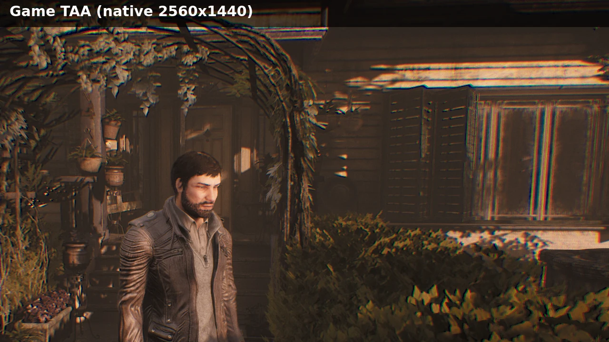

# LumaSongOfHorror

A patched build of the generic Unreal Engine mod from [Luma Framework](https://github.com/Filoppi/Luma-Framework)
that lets FSR 4, FSR 3 and XeSS **upscale** in *Song of Horror*, with a render resolution setting
for their usual presets, instead of only anti-aliasing at native resolution.

Luma Framework is made by Filippo "Pumbo" Tarpini and its contributors. This project is not
affiliated with them; it only carries a few patches on top of their code. All credit for the mod
itself goes to the Luma authors.

> Developed and tested on **Linux only**: AMD Radeon RX 6800 XT (RDNA 2), FSR 4 (INT8), a
> Proton-CachyOS 11.0 based build. Windows, NVIDIA GPUs and other Unreal Engine games are untested.
> FSR 4, FSR 3 and XeSS (through DX12 interop, as on any non-Intel GPU) were tested.
>
> Only works with the latest Steam build of the game, **build 8260563**
> ([SteamDB patch notes](https://steamdb.info/app/1096570/patchnotes/)). Other builds and stores
> are not supported.



*1:1 crop of a 2560x1440 frame: the game's own TAA, then FSR 4 at each Render Resolution preset.*

## What the patches change

Luma's Unreal Engine mod replaces the game's TAA with an upscaler, but always told the upscaler that
the game rendered at full output resolution, so it could only be used as native AA. The patched mod:

- adds a **Render Resolution** setting (the selected upscaler's presets or a custom value), which
  sets Unreal's `r.ScreenPercentage` and enables its TAA upsampling, so the game renders below the
  output resolution and TAA outputs at full resolution;
- passes the resolution the game actually rendered at to the upscaler, so it upscales from it, and
  sets the upscaler up for that fixed resolution rather than for dynamic resolution;
- accepts the slightly different aspect ratio and larger TAA jitter Unreal uses at those
  resolutions;
- decodes motion vectors with texture coordinates based on the real size of Unreal's scene
  textures, which are padded beyond the render resolution.

Two other patches make Luma build with clang-cl, and make FSR 3 log its render and output
resolution like FSR 4 and XeSS do. The patches are in [`patches/`](patches); the
Luma source is the [`Luma-Framework`](Luma-Framework) submodule, pinned to the upstream commit they
apply to.

DLSS is not included in this build: NVIDIA's DLSS SDK license requires NVIDIA branding inside the
application, which a mod cannot provide.

## Installation

1. Download `LumaSongOfHorror-<version>.zip` from the
   [releases](https://github.com/matteo-pacini/LumaSongOfHorror/releases) and extract it into the
   folder with the game's executable:
   `steamapps/common/SongOfHorror/SongOfHorror/Binaries/Win64/`
   (next to `SongOfHorror-Win64-Shipping.exe`).
   The `-Test` zip is the same mod built in Luma's Test configuration: it adds an **Info** tab to
   the overlay (render and output resolution) and logs why the upscaler isn't used, if it isn't.
2. In Steam, set the game's compatibility tool to Proton-CachyOS.
3. Install the Visual C++ 2022 runtime in the game's prefix (the one Steam installs is too old for
   the mod):
   ```sh
   protontricks 1096570 -q vcrun2022
   ```
4. Launch the game once and quit, so it creates its config files. Then add the lines below to
   `steamapps/compatdata/1096570/pfx/drive_c/users/steamuser/AppData/Local/SongOfHorror/Saved/Config/WindowsNoEditor/Engine.ini`
   (in the Steam library that contains the game). Edit it only while the game is closed, as the
   game rewrites the file when it exits.
   ```ini
   [SystemSettings]
   r.DefaultFeature.AntiAliasing=2
   r.PostProcessAAQuality=4

   [/Script/Engine.Engine]
   bSmoothFrameRate=False
   ```
5. Set the game's launch options:
   ```sh
   FSR4_UPGRADE=1 PROTON_FSR4_UPGRADE=1 WINEDLLOVERRIDES="dxgi=n,b" %command% -dx11
   ```
   Optional extras that were used during testing: `PROTON_ENABLE_WAYLAND=1`, `MANGOHUD=1` and
   `gamemoderun` (before `%command%`).
6. In game, set the anti-aliasing option to its highest value. Press `Home` to open the
   ReShade/Luma overlay and set **Super Resolution** to **FSR 4 (DX12 Interop)** (or FSR 3 or
   XeSS) and **Render Resolution** to a preset. Then restart the game once (see
   [Troubleshooting](#troubleshooting)).

### What the settings do

| Setting | Purpose |
|---|---|
| Render Resolution | **Game Setting** leaves the render resolution to the game's own option. The other presets override it, and the game's option has no effect. They are named after the selected upscaler's presets. With FSR: Native AA renders at 100% (the upscaler only replaces TAA), Quality at 66.7%, Balanced at 58.8%, Performance at 50% and Ultra Performance at 33.3%. With XeSS: Native AA at 100%, Ultra Quality Plus at 76.9%, Ultra Quality at 66.7%, Quality at 58.8%, Balanced at 50%, Performance at 43.5% and Ultra Performance at 33.3%. |
| `r.DefaultFeature.AntiAliasing=2`, `r.PostProcessAAQuality=4` | Forces Unreal's TAA on; Luma replaces that pass with the upscaler. |
| `bSmoothFrameRate=False` | Removes the default 62 FPS cap. |
| `PROTON_FSR4_UPGRADE=1` | Proton-CachyOS downloads AMD's FSR 4 driver component (`amdxcffx64.dll`) into the prefix. |
| `FSR4_UPGRADE=1` | Read by Proton-CachyOS's AMD driver layer (`amdxc64`) to offer FSR 4 on GPUs older than RDNA 4. |
| `WINEDLLOVERRIDES="dxgi=n,b"` | Loads ReShade (the mod's `dxgi.dll`) instead of Wine's built-in DXGI. |
| `-dx11` | The mod only supports DirectX 11. |

## Checking that it works

Under **Render Resolution**, the overlay shows the resolution the game renders at and the output
resolution. Luma also writes them to `ReShade.log`, next to the game's executable. This is from a
test run with the Quality preset at 2560x1440 (ReShade's path shortened):

```
22:57:48:334 [  376] | INFO  | Initializing crosire's ReShade version '6.8.0.1' (64-bit) loaded from '...\Win64\dxgi.dll'
22:57:50:427 [  376] | INFO  | Registered add-on "Luma" v0.0.0.0 using ReShade API version 20.
22:57:50:936 [  376] | INFO  | [Luma] FSR4: Initialized FSR 4.1.2
22:57:52:225 [  996] | INFO  | [Luma] UE4: Render scale console variables: r.ScreenPercentage found (100), r.TemporalAA.Upsampling found (1)
22:58:09:187 [ 1232] | INFO  | [Luma] UE4: Detected UE4 TAA. Hash: 0xC38EDE56
22:58:09:208 [ 1232] | INFO  | [Luma] FSR4: Created context (render 2560x1440, output 2560x1440), provider "4.1.2"
22:58:09:258 [ 1232] | INFO  | [Luma] UE4: Detected UE4 TAA. Hash: 0xC828F120
22:58:09:278 [ 1232] | INFO  | [Luma] FSR4: Created context (render 1708x960, output 2560x1440), provider "4.1.2"
```

The first context is created in the main menu, which the game always renders at full resolution;
the second one, once in game, upscales from 1708x960. FSR 3 logs
`FSR3: Created context (render WxH, output WxH)` and XeSS logs
`XeSS: Initialized the context (render WxH, output WxH, quality preset N)` instead.

## Troubleshooting

- **"Fatal error" right at startup:** the Visual C++ 2022 runtime is missing from the prefix
  (installation step 3).
- **The game crashes or hangs with no window:** the Mesa anti-lag Vulkan layer
  (`ENABLE_LAYER_MESA_ANTI_LAG=1`) and Proton's OptiScaler (`PROTON_USE_OPTISCALER=1`) both crash
  or hang the game with this mod. Leave them out of the launch options.
- **The image gets softer after picking Quality or lower, but the overlay still shows the full
  render resolution:** Unreal uses a different TAA shader below about 71%, and Luma only recognizes
  it when the game creates it while loading. Restart the game with the preset selected.
- **`xessD3D12Execute failed, error = -4` (jitter offset out of range) in the log after changing
  the preset:** for a frame after a change, the render resolution and TAA jitter the mod reads
  from Unreal don't match yet, and XeSS rejects the jitter, so it skips that frame. It's harmless.
- **The Render Resolution setting is greyed out:** the game's executable isn't the supported
  Steam build.
- **FPS stuck at 62:** check `bSmoothFrameRate=False` in `Engine.ini`.

## Building

The addon is cross-compiled on Linux with clang-cl and lld-link against the MSVC runtime (via
[xwin](https://github.com/Jake-Shadle/xwin)) and the Windows SDK (from Microsoft's
`Microsoft.Windows.SDK.CPP` NuGet packages). Everything else comes from the Nix devShell.

```sh
git clone --recursive https://github.com/matteo-pacini/LumaSongOfHorror
cd LumaSongOfHorror
nix develop

./scripts/apply-patches.sh   # applies patches/ to the Luma-Framework working tree
./scripts/fetch-sdk.sh       # downloads the MSVC runtime and Windows SDK; accepts Microsoft's license terms
cmake -S . -B build -G Ninja -DCMAKE_TOOLCHAIN_FILE=cmake/clang-cl-xwin.cmake -DCMAKE_BUILD_TYPE=Release
cmake --build build
```

Development helpers:

- `./scripts/deploy.sh build` copies the built addon and the Unreal Engine shaders into the game
  (set `GAME_BIN` if the game is not in `/mnt/games/SteamLibrary`); `./scripts/deploy.sh --restore`
  puts the previous files back.
- `-DLUMA_TEST_BUILD=ON` builds like Luma's Test configuration (the `-Test` zip).
- `./scripts/package.sh build <version> [Test]` creates the release zip in `dist/`.
- `./scripts/fix-case.sh` rebuilds until no include or library is missing, adding symlinks for
  file names that only differ in letter case (Windows sources are not case sensitive). It is only
  needed after updating Luma-Framework.

`compat/atlbase.h` stands in for the few ATL classes Luma uses, as xwin does not ship ATL.

CI ([`.github/workflows/build.yml`](.github/workflows/build.yml)) builds and packages both zips on
every push; pushing a `v*` tag publishes them as a GitHub release.

## License

The files of this repository are MIT licensed ([LICENSE](LICENSE)). The patches, Luma Framework
and the built addon are covered by Luma Framework's license ([LICENSE.Luma](LICENSE.Luma)), which
requires crediting its authors and asking them before any commercial use. The release zips also
contain ReShade, AMD FidelityFX, Intel XeSS and other third-party components; their licenses are
in their `Licenses/` folder.
